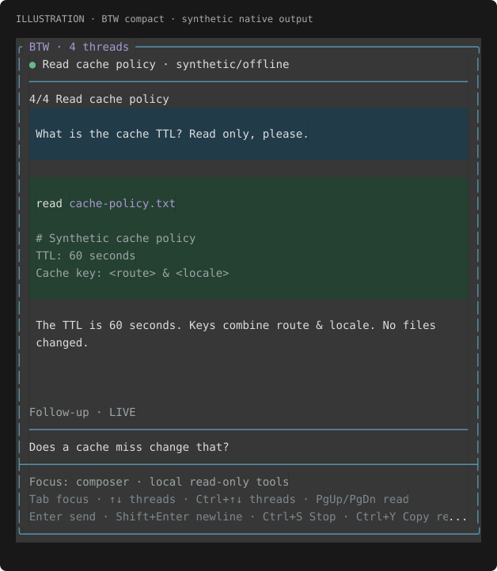

# pi-btw

Independent, read-only side conversations for **Pi 1.5.2**. Ask a question without
interrupting the main agent or adding the side conversation to its future model context.
The package identity is `@howarewoo/pi-btw`; it is not published to npm.


_Two-panel BTW hub with colored status circles and a neutral gray panel, rendered by
the production UI with synthetic in-memory data. Not a terminal screenshot or
live-provider evidence._

## Install

Requires Node.js >=22.19.0, Pi 1.5.2 and a working model/provider login. Review extension source before installing:
extensions themselves run with Pi's operating-system permissions.

```sh
pi install git:github.com/howarewoo/pi-btw
```

**Future npm installation — unavailable now:** after a separately authorized first
publication of `@howarewoo/pi-btw@0.1.0`, the planned command is
`pi install npm:@howarewoo/pi-btw@0.1.0`. Do not use it yet; the package is unpublished.
GitHub Actions release preparation does not establish npm account access or trusted-publisher
configuration. Maintainers: see the [release guide](https://github.com/howarewoo/pi-btw/blob/main/docs/releasing.md).

For local development:

```sh
git clone https://github.com/howarewoo/pi-btw.git
cd pi-btw
npm ci
npm run typecheck
npm test
pi install .
```

Restart Pi, or run `/reload` in an existing idle session after installing. The package
loads only `src/index.ts`; source modules, README and its images, changelog, and license
are included in its install contents. No build step is required. For a one-invocation trial without
changing package settings, use `pi -e ./src/index.ts` from the checkout.

### Moving from the older unscoped pi-btw extension

This is a standalone replacement, not an upgrade of the unscoped npm package. Before
installing, use `pi list` and `pi config` to identify the old package or extension.
Disable/remove that old extension yourself, then install this package and reload. Do not
leave both enabled: they register the same `/btw` command and Pi may suffix the names.
There are no old aliases, mode commands, model overrides, or old-history migration.
Old saved session data is not deleted or imported.

## Use the hub

- **`/btw <prompt>`** always creates a fresh UUID-identified thread, even for an identical
  prompt. It selects the thread, starts its request, and opens the hub.
- **`/btw`** only opens the hub. It does not create a thread or make a model request.
- Write a follow-up in the selected thread's composer. Different threads run concurrently.
  Submitting to a busy thread is visibly rejected and keeps the draft; nothing is queued or steered.

The centered overlay uses approximately 90% of the terminal. Wide terminals show the
oldest-first roster (new threads append at the bottom) on the left and native Pi chat/tool components on the right.
Status circles appear beside each title and in the selected header: accent ◉ starting/running,
green ● idle, red ● failed, muted ○ cancelled, warning ○ interrupted. The separate
› marker indicates selection. Panel backgrounds are neutral gray at the current
theme’s lightness; native user/tool blocks keep their own styling.
Narrow terminals show the selected thread with compact navigation. Very small terminals
ask you to resize rather than accepting invisible composer input.



_Compact selected-conversation view with a status circle and neutral panel from the
same production renderer and synthetic threads. Not a terminal screenshot or
live-provider evidence; narrow layouts truncate some shortcut hints, while the full
controls are listed below._

| Control | Action |
| --- | --- |
| Esc | Close the hub, **without stopping requests** |
| Tab | Switch between composer and roster focus |
| Up / Down in either pane | Select the previous/older or next/newer thread (no wrap) |
| Enter in roster | Focus the composer |
| Ctrl+Up / Ctrl+Down | Select the previous/older or next/newer thread from either panel |
| Enter in composer | Send follow-up |
| Shift+Enter or Ctrl+J | Insert a newline |
| PageUp / PageDown | Scroll the selected transcript |
| Mouse wheel over transcript (Pi fullscreen mode) | Scroll the selected transcript |
| Ctrl+End | Return to live output at the bottom |
| Ctrl+S | **Stop only the selected thread's current request** |
| Ctrl+Y | Copy the latest assistant reply |
| Alt+Y | Copy the user/assistant conversation with Markdown role labels |

Composer submit, newline, thread navigation, and cancel honor Pi's corresponding TUI
keybindings. Plain Up/Down are always reserved for thread navigation, even in the
multiline composer; use other editor controls (Left/Right, Home/End, etc.) to edit.
Ctrl+Up/Down remain fixed navigation aliases. The other hub shortcuts above are fixed. Modified-key support depends on
your terminal; see Pi's terminal setup documentation.

Drafts and reading position are kept per thread when switching or closing/reopening the
hub in the same runtime. Streaming follows the bottom until you scroll up; scrolling back
to the bottom or pressing Ctrl+End resumes live output. The selected header and its
separator stay fixed while the transcript scrolls. Native wheel scrolling is available
only in Pi fullscreen mode and only over the transcript (not the roster, header, or
composer). In regular mode the terminal owns mouse scrolling; use PageUp/PageDown
and Ctrl+End to scroll the BTW transcript instead. Stop retains
the SDK's partial assistant response. A failed, cancelled, or interrupted thread accepts
new follow-ups; other threads are unaffected.

Copy excludes inherited parent context, thinking, tool calls/results, terminal escapes,
and UI framing. Partial text can be copied; the notice reports the observed thread state.
Pi's exported clipboard helper is used, and errors are shown rather than reported as success.

## Context and read-only boundary

At creation, the extension captures the **current parent's branch model context once**
(with compaction applied) and its effective system/project instructions. That snapshot
is persisted with the thread, kept separate from visible/copyable side messages, and
never refreshed from later parent conversation turns. Later follow-ups use only that
snapshot and their own thread history. Child reads can still see subsequent local file changes.

Each turn inherits the parent's current model and thinking level. The hub displays the
selected/effective model; it never silently substitutes a different model when authentication
fails. Provider or credential failures are visible on that thread. There are no override controls.

Each child is a real SDK session with **only `read`, `grep`, `find`, and `ls` registered**.
An explicit tool allowlist and a resource loader with no extensions, skills, templates,
or arbitrary resource discovery enforce this structurally—not just through a prompt.
Inherited historical tool calls do not grant tools. There is no bash, edit, write,
subagent, MCP, codemode, or SSH support in children.

This is a capability restriction, **not a filesystem sandbox**: the four tools can read
local paths accessible to Pi, including paths outside the working directory. The extension
itself and the model provider remain trusted code. Do not ask it to read secrets.

## Persistence and recovery

Thread snapshots and SDK transcripts are stored in versioned, hidden custom entries
(`howarewoo.btw.v1`) in the **parent session file**. These entries do not enter the parent's
model context and do not create visible save notes. They can contain the same sensitive
conversation/project information as the parent; protect the session file accordingly.

Creation and meaningful message/turn checkpoints are saved. Restoration reads only the
current session branch. Unfinished restored turns become **interrupted**, and no paid
request is automatically replayed. An abrupt crash can lose an unfinished streaming tail
since the last checkpoint. Resume manually with a follow-up if you want another call.

Clean reload, shutdown, session replacement, and tree navigation stop/dispose the affected
children. Late async completions cannot append into a replacement branch/session. Returning
to an older branch restores its last saved state rather than importing another branch's threads.
Drafts and viewport positions are runtime-only and are not restored after restart/reload.
`--no-session` parent sessions are ephemeral, including their BTW checkpoints.

No automatic compaction or retry is enabled in child sessions. Very long side threads may
hit provider context limits and fail visibly; start a fresh `/btw <prompt>` when needed.

## Verification and limits

`npm test` uses Node's test runner and the real Pi 1.5.2 SDK with a deterministic provider
fixture. It checks tool declarations and execution/rejection, context isolation, concurrency,
stop, restore/branch fencing, commands, copy filtering, and Unicode/narrow/wide hub rendering.
`npm run typecheck` checks source and fixtures. `npm run check` runs both gates.
`npm run release:check` validates planned release metadata; `npm run test:package` packs,
inspects and installs the actual tarball in a disposable offline consumer, then checks Pi
1.5.2 loading and the noninteractive command boundary. These do not publish or verify npm
account access. `npm pack --dry-run` only lists install contents.

A small offline model fixture in `test/interactive-fixture.ts` is available for isolated
manual TUI checks; it is not installed with the package. Automated SDK tests and an offline
TUI smoke do not establish live-provider compatibility or every terminal/clipboard backend.
Compatibility beyond Pi 1.5.2 is not claimed.

### Regenerate README illustrations

From a checkout after `npm ci`, run `npm run render:readme` to regenerate
`docs/images/btw-hub.svg` and `docs/images/btw-compact.svg`. The generator uses the
production hub and native Pi transcript components with synthetic `Threads` and
in-memory `SessionManager` data only. It loads no parent session and makes no provider
requests. It uses the real theme and live neutral panel paint without illustration-only
theme overrides. The ANSI-to-SVG converter is adapted from pi-extended-subagents (MIT).
The generator and tests are not installed with the package; the README images are.

## License

MIT. Includes adapted SDK isolation patterns from Dan Bachelder's pi-btw and native
transcript rendering from Adam Woo's pi-extended-subagents. See [LICENSE](LICENSE).
