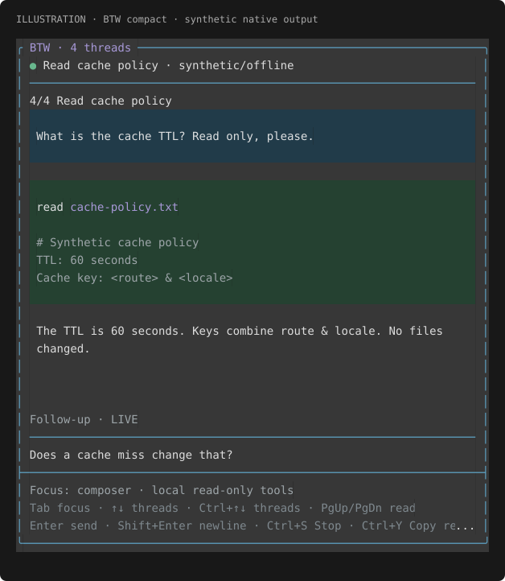

# Using the hub

This page covers the `/btw` command, the hub's layouts and keys, scrolling, stopping requests
and copying replies. For a first run, start with the [README quick start](../README.md#quick-start).

## Commands

- **`/btw <prompt>`** always creates a fresh UUID-identified thread, even for an identical
  prompt. It selects the thread, starts its request, and opens the hub.
- **`/btw`** only opens the hub. It does not create a thread or make a model request.
- Write a follow-up in the selected thread's composer. Different threads run concurrently.
  Submitting to a busy thread is visibly rejected and keeps the draft; nothing is queued or steered.

## Layout

The centered overlay uses approximately 90% of the terminal. Wide terminals show the
oldest-first roster (new threads append at the bottom) on the left and native Pi chat/tool components on the right.
Status circles appear beside each title and in the selected header: accent ◉ starting/running,
green ● idle, red ● failed, muted ○ cancelled, warning ○ interrupted. The separate
› marker indicates selection. Panel backgrounds are neutral gray at the current
theme’s lightness; native user/tool blocks keep their own styling.
Narrow terminals show the selected thread with compact navigation. Very small terminals
ask you to resize rather than accepting invisible composer input.

_Compact selected-conversation view with a status circle and neutral panel from the
same production renderer and synthetic threads. Not a terminal screenshot or
live-provider evidence; narrow layouts truncate some shortcut hints, while the full
controls are listed below._

## Keys

| Control                                          | Action                                                           |
| ------------------------------------------------ | ---------------------------------------------------------------- |
| Esc                                              | Close the hub, **without stopping requests**                     |
| Tab                                              | Switch between composer and roster focus                         |
| Up / Down in either pane                         | Select the previous/older or next/newer thread (no wrap)         |
| Enter in roster                                  | Focus the composer                                               |
| Ctrl+Up / Ctrl+Down                              | Select the previous/older or next/newer thread from either panel |
| Enter in composer                                | Send follow-up                                                   |
| Shift+Enter or Ctrl+J                            | Insert a newline                                                 |
| PageUp / PageDown                                | Scroll the selected transcript                                   |
| Mouse wheel over transcript (Pi fullscreen mode) | Scroll the selected transcript                                   |
| Ctrl+End                                         | Return to live output at the bottom                              |
| Ctrl+S                                           | **Stop only the selected thread's current request**              |
| Ctrl+Y                                           | Copy the latest assistant reply                                  |
| Alt+Y                                            | Copy the user/assistant conversation with Markdown role labels   |

Composer submit, newline, thread navigation, and cancel honor Pi's corresponding TUI
keybindings. Plain Up/Down are always reserved for thread navigation, even in the
multiline composer; use other editor controls (Left/Right, Home/End, etc.) to edit.
Ctrl+Up/Down remain fixed navigation aliases. The other hub shortcuts above are fixed. Modified-key support depends on
your terminal; see Pi's terminal setup documentation.

## Drafts, scrolling and stopping

Drafts and reading position are kept per thread when switching or closing/reopening the
hub in the same runtime. Streaming follows the bottom until you scroll up; scrolling back
to the bottom or pressing Ctrl+End resumes live output. The selected header and its
separator stay fixed while the transcript scrolls. Native wheel scrolling is available
only in Pi fullscreen mode and only over the transcript (not the roster, header, or
composer). In regular mode the terminal owns mouse scrolling; use PageUp/PageDown
and Ctrl+End to scroll the BTW transcript instead. Stop retains
the SDK's partial assistant response. A failed, cancelled, or interrupted thread accepts
new follow-ups; other threads are unaffected.

## Copying replies

Copy excludes inherited parent context, thinking, tool calls/results, terminal escapes,
and UI framing. Partial text can be copied; the notice reports the observed thread state.
Pi's exported clipboard helper is used, and errors are shown rather than reported as success.
